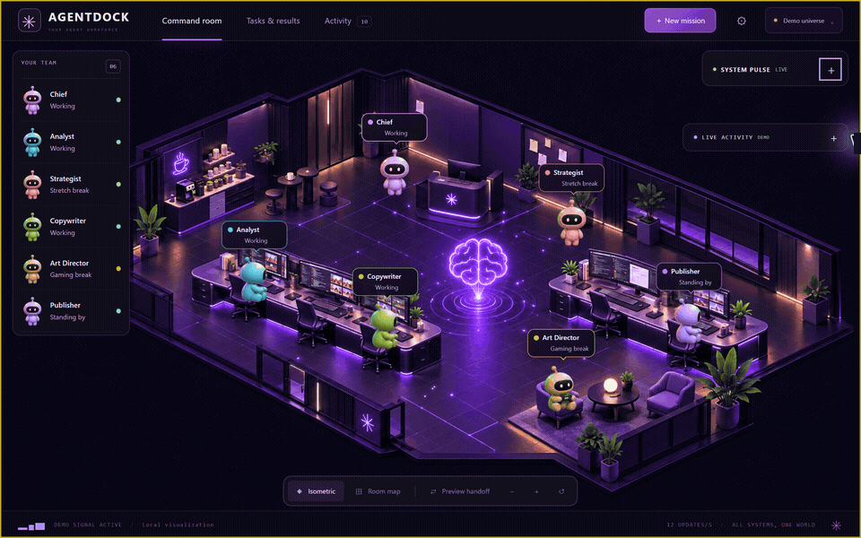
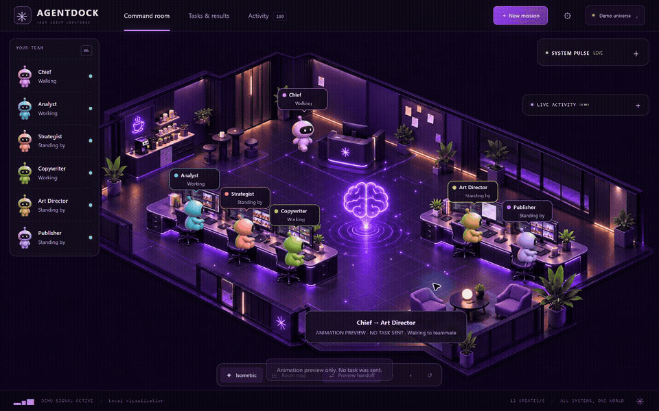

# AgentDock

**A local-first command room for Hermes Agent.** Connect the Hermes profiles you create, assign capabilities to your own workers, and watch delegated work move through an animated isometric workspace.





> Both clips show Demo mode. The cast, task activity, and results are simulated and do not represent or expose any user's Hermes profiles. The walking clip is a visual preview and sends no task.

## Features

- **Live Hermes connection:** Connect your local Hermes coordinator and worker profiles through the API gateway. AgentDock keeps API keys on the server.
- **Mission planning:** Send single or numbered multi-step missions, set task dependencies, inspect worker assignments, and review completed results or failures.
- **Prompt extraction:** Extract still-image prompts, video prompts, or both from DOCX, text PDF, TXT, Markdown, JSON, or pasted source text.
- **Research and narration:** Assign topic research and narration-writing capabilities to the Hermes profiles you choose. Research workflows can use Hermes web tools and return linked sources.
- **Structured scenes:** Assign scene authoring to a profile with the included `aether-scenes` plugin. AgentDock preserves narration and checks requested scene and callout counts.
- **Optional Google Flow generation:** Assign image generation to your own profile and configure its Chrome and Flow integration. Flow-specific tools and service access are not included in this repository.
- **Local command room:** View mission state, profile activity, local hardware readings, and animated delegation. Demo mode runs without Hermes.

## Quick start

### Requirements

- Windows 10 or 11 for `Start AgentDock.cmd`.
- Node.js 22 or newer and npm.
- A local Hermes Agent install and API gateway for live mode.

### Run the demo

```powershell
npm.cmd ci
npm.cmd start
```

Open [http://127.0.0.1:4317](http://127.0.0.1:4317) and leave **Demo universe** selected. Or double-click `Start AgentDock.cmd` on Windows.

### Connect your Hermes profiles

1. Create and configure your own profiles in Hermes. AgentDock does not create profiles or ship an example team.
2. Copy `.env.example` to `.env` and replace the sample IDs, profile names, URLs, and API keys with your own.
3. Set `nativeCoordinator: true` on the profile that will receive your requests. Give worker entries `reportsTo` pointing at that entry's AgentDock ID.
4. Add capability IDs to the worker profiles that should handle each workflow. Do not add a capability unless that profile has the matching Hermes tools enabled.
5. Configure the coordinator's Hermes `advanced-delegation` plugin to use Profile routes and allow the worker profile names you configured.
6. Restart AgentDock, open the connection menu, choose the local Hermes connection, and send a small mission.

See [Installation](docs/INSTALLATION.md), [Hermes setup](docs/HERMES_SETUP.md), and the [User guide](docs/USER_GUIDE.md) for all setup steps, workflows, and settings.

## Your agents, your workflows

Connect your Hermes profiles and give them tasks based on their tools and expertise. Your team can research, write, code, work with files, and handle other tasks supported by your Hermes setup.

AgentDock also includes built-in workflows for prompt extraction, research, narration, scene authoring, and optional Google Flow image generation. Assign capability labels to route these workflows to the appropriate profiles.

Available actions depend on each profile's enabled tools, permissions, and configuration. See the [Hermes setup guide](docs/HERMES_SETUP.md) for configuration details.

## Demo and privacy

Demo mode uses a separate simulated cast to illustrate the interface. It is not generated from Hermes configuration, and connecting live profiles does not add them to the demo GIFs. In live mode, AgentDock displays the profile IDs, names, and roles that you enter locally.

The bridge binds to loopback by default. Mission records, uploaded copies, and logs are stored under ignored `data/`. Keep `.env` private. Review [Security and privacy](docs/SECURITY_AND_PRIVACY.md) before connecting profiles or sending confidential documents.

## License

AgentDock source code and original documentation use a custom source-available license. It permits personal use and internal business use, but prohibits redistribution, resale, sublicensing, and third-party hosting without written permission. This is **not an OSI-approved open-source license**. Third-party components retain their own licenses; see [LICENSE](LICENSE) and [third-party notices](THIRD_PARTY_NOTICES.md).

This license governs use; it cannot prevent downloads, clones, or forks of a public repository. To restrict who can access the code, make the GitHub repository private. See [GitHub's repository licensing guidance](https://docs.github.com/en/repositories/managing-your-repositorys-settings-and-features/customizing-your-repository/licensing-a-repository).

## Verify locally

```powershell
npm.cmd test
npm.cmd run build
```

The test suite uses local fixtures and does not submit live Hermes tasks or create images. `npm run build` produces a static Demo build; live Hermes operation uses `npm start`.

## Project layout

- `public/` — browser interface and isometric room animation
- `server/` — local Hermes bridge, capability routing, mission planning, and file handling
- `agents/aether-documents/` and `agents/aether-scenes/` — optional Hermes plugins
- `docs/` — installation, Hermes configuration, workflows, privacy, and demo GIFs
- `test/` — automated Node tests
- `.env.example` — generic configuration template; never put real credentials here

Review [third-party notices](THIRD_PARTY_NOTICES.md) before distributing a build or bundled dependency.
